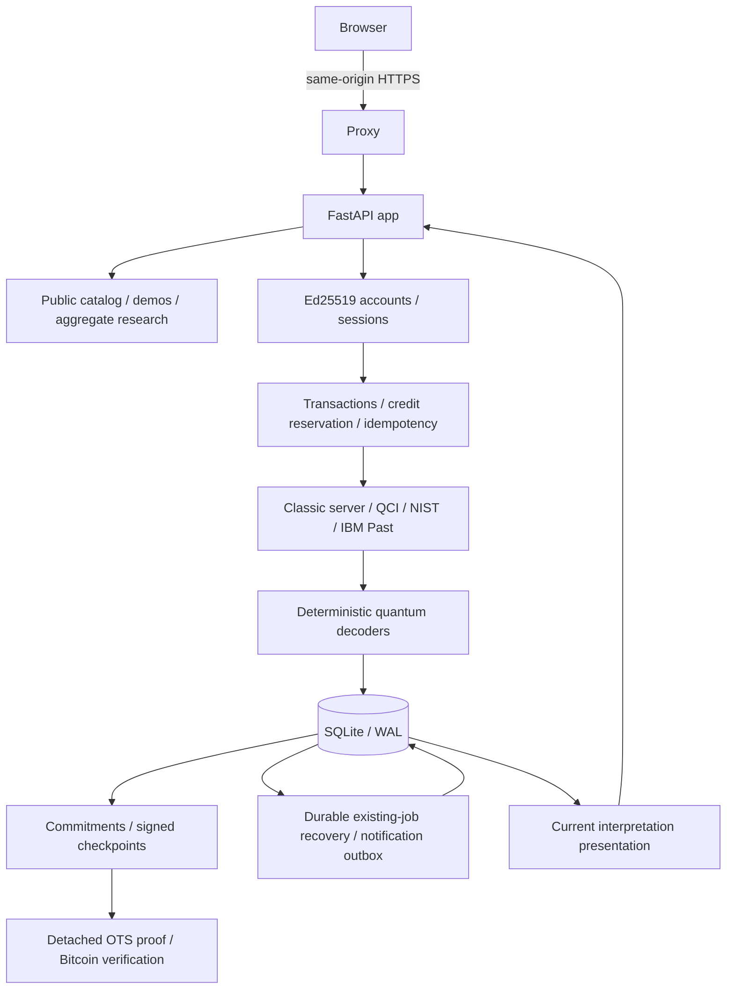

# Architecture

Gnosis is one FastAPI process, a static HTML/CSS/ES-module frontend, a SQLite database in WAL mode, and an independent worker. The web service does not run a background paid job on every HTTP request. No database or provider token belongs in the static directory. Production has one worker/vCPU-facing Uvicorn process initially; horizontal scale would require a separate concurrency review.

Browser I Ching Classic uses `crypto.getRandomValues`; it bypasses the backend. Rune Classic is authenticated server-side cryptographic randomness. QCI is remote entropy; NIST is public pulse derivation; IBM Past uses isolated, approved pre-acquired inventory. IBM Future is an explicitly gated I Ching admin trial and no general live rune submission is offered. No silent provider substitution. Service policy costs and cooldown are server authoritative (`registry.py`, `rune_services.py`, `transactions.py`).

The corpus adapter (`app/services/corpus.py`) checks phase identities against coin/rank-derived patterns and attaches literary interpretation to successful I Ching response envelopes. It does not transform the original database strings or GQTP owner receipt. Oracle deep links load already saved readings without another allocation. Reading resonance is independent, a mutable subjective state.

### Boundaries

- `app/api/`: public endpoints, health reporting; `app/data/`: publishable interpretation and demo objects; `app/static/`: static public assets only.
- `gnosis_platform/`: protected identity, request, stock, measurement, credit, consent and verification records; the admin UI is served only via authenticated admin routes, not the public static mount.
- `quantum/`: importable reference circuits, decoders, QPY and recognition. No web sessions, database mutations, or job execution on import.
- `scripts/`: operator tools, some explicitly authorized paid pilot operations. The systemd services never invoke those submission tools.

The code includes some legacy compatibility route names and markers so old URLs and data replay remain valid. No migration file was renamed or edited in this release; applied SQLite schema history uses the migration filenames as identifiers.
